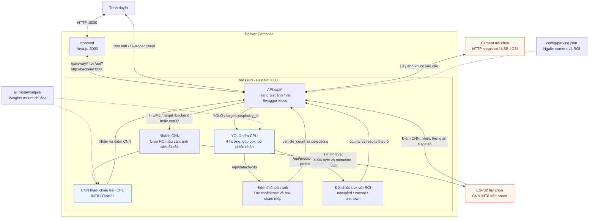
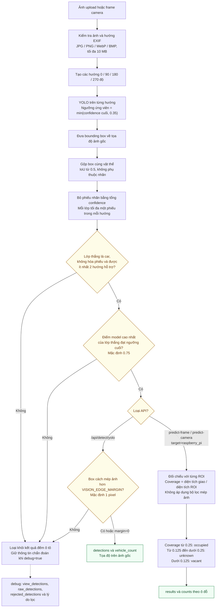
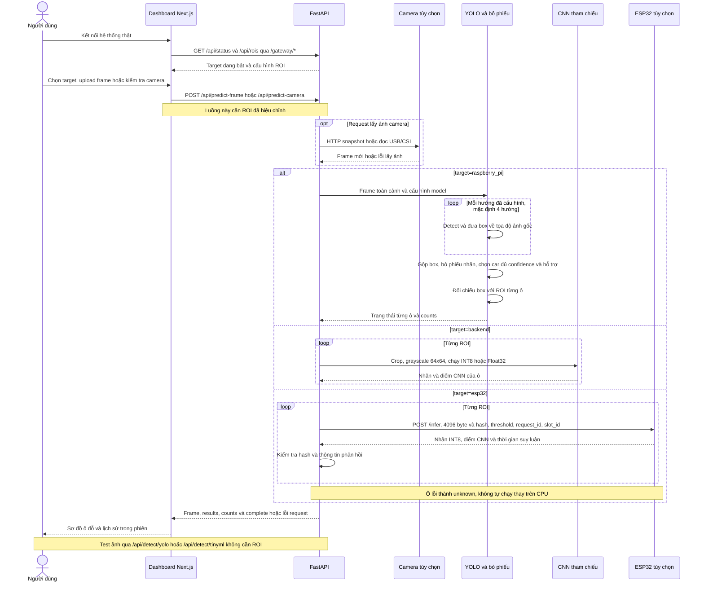

# Smart Parking

Project cá nhân giám sát bãi đỗ xe bằng FastAPI, Next.js, CNN TinyML và YOLO.
Hệ thống có hai cách xử lý ảnh:

| Nhánh | Đầu vào | Kết quả | Nơi chạy |
|---|---|---|---|
| CNN TinyML | Ảnh một ô, hoặc từng ROI trong frame | Có xe / không có xe | CNN INT8 trên ESP32 hoặc CNN INT8/Float32 tham chiếu trên CPU |
| Camera + YOLO | Frame toàn cảnh | Bounding box ô tô; trạng thái từng ô khi có ROI | CPU trên máy chạy backend, có thể triển khai riêng trên Raspberry Pi |

## Chạy nhanh bằng Docker

Bật Docker Desktop ở chế độ **Linux containers**, chạy từ thư mục gốc:

```powershell
# Chỉ tạo .env nếu chưa có; các giá trị mặc định nằm trong .env.example.
if (-not (Test-Path .env)) { Copy-Item .env.example .env }
docker compose up --build -d
docker compose ps
```

| Địa chỉ mặc định | Chức năng |
|---|---|
| http://localhost:3000 | Dashboard quản lý; bấm **Kết nối hệ thống thật** để dùng backend |
| http://localhost:8000/ | Trang test ảnh CNN/YOLO |
| http://localhost:8000/docs | Swagger |
| http://localhost:8000/api/status | Model, target và cấu hình đang chạy |

Compose chạy hai container `frontend` và `backend`. Frontend chỉ khởi động sau
khi backend healthy; Next.js chuyển tiếp `/gateway/*` tới `http://backend:8000/api/*`.
Backend bật cả CNN tham chiếu và YOLO trên CPU, không cần GPU hoặc ESP32 để test ảnh.

Cần có sẵn weights trong `ai_model/output/run_gpu01/` và
`ai_model/output/vision/` như cây thư mục bên dưới. Container mount model và
`config/` chỉ đọc, không tự tải weights khi khởi động. Weights và ảnh test không
được Git theo dõi; khi chép/clone project sang máy khác cần chuẩn bị lại.

```powershell
docker compose logs -f backend        # Xem log
docker compose up --build -d          # Áp dụng thay đổi mã nguồn
docker compose up -d                  # Áp dụng thay đổi .env
docker compose restart backend       # Nạp lại ROI hoặc weights đã thay
docker compose down                  # Dừng hệ thống
```

## Cấu hình

Sửa `.env` ở gốc project; xem đầy đủ trong [.env.example](.env.example).

| Biến | Mặc định | Ý nghĩa |
|---|---|---|
| `FRONTEND_PORT` | `3000` | Cổng giao diện trên host |
| `BACKEND_PORT` | `8000` | Cổng API trên host |
| `MODEL_DIR` | `./ai_model/output/run_gpu01` | Thư mục weights CNN trên host |
| `VISION_MODEL_DIR` | `./ai_model/output/vision` | Thư mục weights YOLO trên host |
| `VISION_MODEL` | `parking-car` | Profile Geo-trax; model khác dùng đường dẫn **trong container** |
| `VISION_CONFIDENCE` | `0.75` | Ngưỡng confidence cuối cho YOLO |
| `VISION_IMAGE_SIZE` | `640` | Kích thước input YOLO, bội số của 32 |
| `VISION_ROTATIONS` | `0,90,180,270` | Các hướng suy luận; `0` để chạy một lượt |
| `VISION_EDGE_MARGIN` | `1` | Khoảng cách tới mép ảnh, pixel; `0` để tính cả xe bị cắt ở mép |
| `VISION_OVERLAP` | `0.25` | Coverage tối thiểu của box xe trên ROI để xác nhận có xe |
| `CONFIG_DIR` | `./config` | Thư mục cấu hình camera trên host |
| `ROI_CONFIG` | `/app/config/parking.json` | Đường dẫn cấu hình **trong container** |
| `ESP32_URL` | Trống | URL LAN của board, ví dụ `http://192.168.1.50` |

Các thư mục trên host phải tồn tại. Ví dụ model tùy chọn:
`VISION_MODEL=/app/ai_model/output/vision/yolo11s.pt`.
Đặt `ESP32_URL` sẽ bật thêm kết nối board, vẫn giữ CNN tham chiếu và YOLO.

## Cấu trúc thư mục

```text
Project-3/
├── compose.yaml                    # Chạy frontend và backend
├── .env.example                    # Cấu hình mẫu cho Compose
├── backend/
│   ├── app.py                      # App factory, lifespan và CLI
│   ├── api/endpoints/              # Status, CNN, camera và hai API detect
│   ├── config/                     # Đọc ROI, profile YOLO và giá trị mặc định
│   ├── model/
│   │   ├── inference.py            # CNN, preprocessing và điều phối ESP32
│   │   ├── vision.py               # YOLO, suy luận đa hướng, kết quả theo ROI
│   │   └── vision_fusion.py        # Hoàn nguyên box, gộp và bỏ phiếu nhãn
│   ├── schemas/                    # Kiểm tra cấu hình và response API
│   ├── service/                    # HTTP ESP32, camera capture, xử lý frame
│   └── Dockerfile
├── frontend/                       # Dashboard Next.js / React / TypeScript
├── dashboard/                      # Trang test ảnh do FastAPI phục vụ tại /
├── config/                         # Mẫu ROI/camera và nhãn ảnh test
├── ai_model/
│   ├── *.py                        # Chuẩn bị dữ liệu, train, export, đánh giá
│   └── output/
│       ├── run_gpu01/
│       │   ├── parking_cnn_int8.tflite
│       │   ├── parking_cnn.keras    # Cần khi muốn dùng Float32
│       │   └── model_data.h        # Header tương ứng để nạp ESP32
│       └── vision/
│           └── geotrax_hbb_yolov8s_1920_v1.pt
├── firmware_esp32/esp32_parking_inference/
│                                   # Firmware CNN INT8 và cấu hình Wi-Fi
├── test_image/                     # Ảnh kiểm tra local
├── tests/                          # API, hình học ROI, bỏ phiếu và tích hợp model
└── docs/diagrams/                   # Ba sơ đồ Mermaid của hệ thống
```

`vision_fusion.py` gộp **dự đoán ảnh từ nhiều hướng**. Driver cảm biến khoảng cách
và sensor fusion chưa được triển khai. `backend/database/` hiện chỉ là thư mục dự phòng.

## Kiến trúc hệ thống

<!-- diagram: docs/diagrams/system_architecture.mmd -->


Nguồn sơ đồ: [system_architecture.mmd](docs/diagrams/system_architecture.mmd).
Camera và ESP32 là thiết bị tùy chọn bên ngoài container. Nhãn target
`raspberry_pi` chỉ nhánh YOLO; khi backend chạy trên PC, suy luận vẫn chạy trên CPU PC.

## API và test ảnh

Các API upload dùng multipart field `file`, hỗ trợ JPG/PNG/WebP/BMP, tối đa **10 MB**.

| Method | Endpoint | Công dụng |
|---|---|---|
| GET | `/health` | Backend sẵn sàng; không xác nhận board ESP32 online |
| GET | `/api/status` | Model, target, cấu hình YOLO và số ROI |
| GET | `/api/rois` | Cấu hình camera/ROI hiện tại |
| POST | `/api/detect/tinyml` | Ảnh một ô đỗ; mặc định CNN INT8 trên backend |
| POST | `/api/detect/yolo` | Đếm ô tô, trả bounding box trên toàn ảnh; không cần ROI |
| POST | `/api/predict` | API CNN một ô, chọn `target=backend` hoặc `esp32`; mặc định `esp32` |
| POST | `/api/predict-frame` | Upload frame, trả trạng thái từng ROI |
| POST | `/api/predict-camera` | Lấy ảnh camera đã cấu hình rồi xét từng ROI |

```powershell
# CNN: ảnh đã crop một ô; thêm ?model=float để dùng Float32.
curl.exe -X POST "http://localhost:8000/api/detect/tinyml" -F "file=@test_image/test2-car.jpg"

# YOLO: ảnh toàn cảnh. Thêm debug=true để xem bằng chứng từng hướng và box bị loại.
curl.exe -X POST "http://localhost:8000/api/detect/yolo?debug=true" -F "file=@test_image/test2.jpg"

# Trạng thái các ô bằng YOLO: cần config/parking.json phù hợp với frame.
curl.exe -X POST "http://localhost:8000/api/predict-frame?target=raspberry_pi" -F "file=@test_image/test2.jpg"
```

Hai API theo ROI nhận target `backend`, `esp32` hoặc `raspberry_pi`; mặc định là
`esp32`. Trên dashboard, chọn target phù hợp trong **Camera & thiết bị**.
Ảnh toàn cảnh đưa vào CNN sẽ được xử lý theo các ROI đã khai báo; ảnh đưa vào
`/api/detect/tinyml` phải thể hiện một ô đỗ.

## Luồng YOLO đa hướng

<!-- diagram: docs/diagrams/yolo_detection.mmd -->


Nguồn sơ đồ: [yolo_detection.mmd](docs/diagrams/yolo_detection.mmd).
Sơ đồ mô tả cấu hình mặc định bốn hướng. Gộp theo hình học giúp các nhãn `car`
và `truck` của cùng vật thể được đối chiếu trước khi chọn lớp; không đổi mọi `truck`
thành `car`. Box đầu ra là trung bình theo trọng số confidence của lớp thắng.

`confidence` trả về là điểm model cao nhất của lớp thắng. `class_votes` là tổng
trọng số dùng chọn nhãn, không phải xác suất. Với `VISION_ROTATIONS=0`, hệ thống
chạy một lượt, bỏ bước bỏ phiếu và chỉ cần hỗ trợ từ một hướng.

API đếm toàn ảnh bỏ box chạm mép theo `VISION_EDGE_MARGIN`; API theo ROI vẫn dùng
xe hiện một phần để xét ô đỗ. Coverage được tính trên diện tích **ROI**, không phải
IoU. Các mốc trạng thái trong sơ đồ tương ứng `VISION_OVERLAP=0.25`.

Trong các ảnh kiểm thử hiện có, `test1.jpg` trả **5 ô tô**, `test2.jpg` trả **2 ô tô**
ở cả confidence 0.35 và 0.75. Bốn hướng cần bốn lượt suy luận; chưa đo hiệu năng
trên Pi. `test-crop.jpg` vẫn có thể bị bỏ sót; kết quả local chưa thay cho kiểm chứng
trên ảnh camera độc lập.

## Camera, ROI và luồng kiểm tra ô đỗ

Tạo `config/parking.json` từ [parking.example.json](config/parking.example.json)
hoặc [parking.vision.example.json](config/parking.vision.example.json), hiệu chỉnh
`reference_width`, `reference_height` và ROI từng ô theo ảnh camera thực tế.
Các tọa độ mẫu chỉ minh họa; tỷ lệ ảnh đưa vào cần khớp tỷ lệ ảnh tham chiếu.

Chọn một nguồn camera: `snapshot_url` HTTP(S), `capture_device` cho USB hoặc
`use_picamera2` cho CSI. Trong Docker, camera HTTP trên host dùng
`host.docker.internal`; camera LAN dùng IP LAN. USB cần ánh xạ thiết bị, CSI cần
driver Picamera2; Compose mặc định phục vụ upload/HTTP snapshot. Chưa có adapter RTSP.

<!-- diagram: docs/diagrams/system_sequence.mmd -->


Nguồn sơ đồ: [system_sequence.mmd](docs/diagrams/system_sequence.mmd).
Thiếu ROI vẫn dùng được hai API `/api/detect/*`; API theo ô trả lỗi 409.
Gateway không tự chuyển sang CNN trên PC khi ESP32 lỗi. Lỗi từng ô được trả dưới
trạng thái `unknown`; lỗi nguồn ảnh hoặc request trả mã HTTP lỗi phù hợp.

Dashboard giữ tối đa 100 lần kiểm tra trong phiên. Chế độ tự kiểm tra gọi camera
mỗi 30 giây khi tab hiển thị; không có worker chạy nền khi đóng trang. Hiện chưa có
cơ sở dữ liệu lưu lịch sử, xác thực người dùng hoặc API CRUD cấu hình.

## Chạy trực tiếp và kết nối ESP32

Từ thư mục gốc trên Windows:

```powershell
python -m venv .venv-vision
.\.venv-vision\Scripts\python.exe -m pip install -r backend\requirements-comparison.txt
# Chạy nếu chưa có weights YOLO; script kiểm tra hash của profile parking-car.
.\.venv-vision\Scripts\python.exe -m ai_model.prepare_vision_model --model parking-car
.\.venv-vision\Scripts\python.exe -m backend.app --enable-reference --vision-model parking-car
```

Trong terminal khác:

```powershell
cd frontend
npm.cmd ci
npm.cmd run dev
```

Frontend local mặc định chuyển tiếp tới `http://127.0.0.1:8000`. Đổi
`BACKEND_URL` trong `frontend/.env.local` trước khi dev/build nếu dùng backend khác.
Chỉ chạy YOLO thì bỏ `--enable-reference`; thêm `--esp32-url http://IP_ESP32` nếu
cần board. CLI có `--vision-confidence`, `--vision-rotations`, `--vision-edge-margin`
và `--roi-config` để tùy chỉnh tương tự Compose.

Với ESP32, sửa Wi-Fi trong `firmware_esp32/esp32_parking_inference/esp32_config.h`,
dùng `model_data.h` khớp model INT8 rồi nạp bằng Arduino IDE với thư viện
TensorFlow Lite Micro tương thích. Xem IP trên Serial Monitor 115200 và kiểm tra
`http://IP_ESP32/health`. Gateway truyền raw grayscale 64×64, không truyền JPEG;
phản hồi phải khớp hash model và định danh request/ô đỗ.

## Train và kiểm thử

CNN dùng dataset `train/val/test`, mỗi tập có `vacant/occupied`. Cài dependencies
trong `ai_model/requirements.txt`, rồi dùng thư mục output mới:

```powershell
python -m ai_model.check_dataset --dataset-dir ai_model/dataset
python -m ai_model.train_and_quantize --dataset-dir ai_model/dataset --output-dir ai_model/output/run_new --epochs 40 --batch-size 32 --device cpu
```

GPU trên Windows dùng môi trường Ubuntu/WSL2 riêng với
`ai_model/requirements-gpu.txt` và `--device gpu`. Model YOLO hiện dùng weights
pretrained; project chưa có pipeline fine-tune YOLO riêng. `ai_model/evaluate_vision.py`
kiểm tra baseline một hướng của weights, không áp dụng bỏ phiếu/lọc mép như API.
Các script trong `ai_model/` có `--help` để xem tùy chọn.

```powershell
.\.venv-vision\Scripts\python.exe -m pip install httpx
.\.venv-vision\Scripts\python.exe -X utf8 -m unittest discover -s tests -v
```

Test model thật được bỏ qua nếu thiếu weights/ảnh local. Các test dùng thiết bị
và driver giả không thay cho kiểm chứng trên ESP32, Pi và camera thật.
