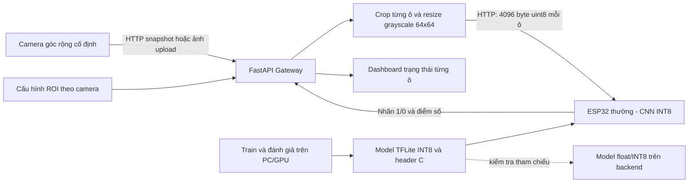
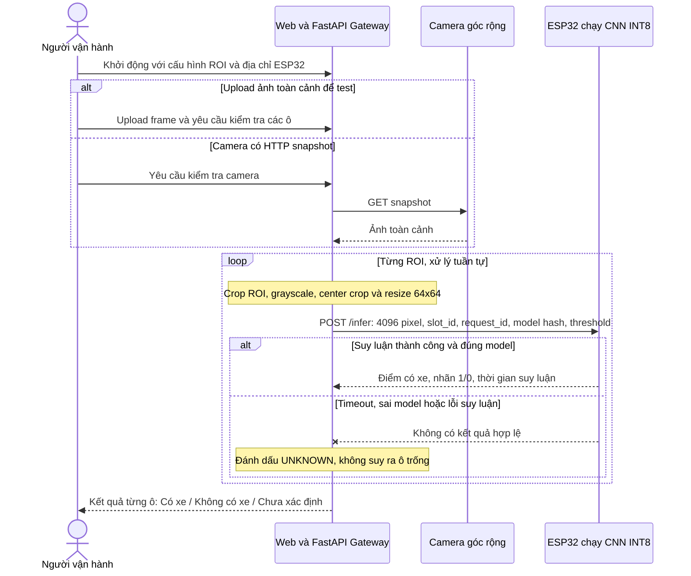

# Wide-angle Smart Parking — Camera ROI và ESP32 INT8

Project giám sát trạng thái từng ô đỗ bằng **camera cố định góc rộng** và **ESP32 thường chạy model CNN INT8**. Camera, gateway và node suy luận là các thiết bị/thành phần tách biệt.

```text
Camera góc rộng → FastAPI crop từng ROI → ảnh xám 64×64 → ESP32 → kết quả từng ô → Web
```

| Nhãn/trạng thái | Ý nghĩa |
|---|---|
| `1` / `occupied` | Có xe |
| `0` / `vacant` | Không có xe |
| `unknown`, `label: null` | Chưa có kết quả hợp lệ, ví dụ mất kết nối ESP32 |

ESP32 không nhận video HD, không giải mã JPEG và không điều khiển camera. Gateway trên PC/mini PC nhận frame, cắt vùng từng ô và gửi **4096 byte pixel uint8** mỗi request. ESP32 tự lượng tử hóa, chạy TFLite Micro và trả điểm có xe/nhãn. Các ô được xử lý tuần tự trên một node.

## Kiến trúc hệ thống



Luồng triển khai dùng `target=esp32`. Backend có chế độ `target=backend` để so sánh float/INT8 trên máy tính; chế độ này phải được chọn rõ ràng, không tự thay thế ESP32 nếu thiết bị lỗi.

## SSD — System Sequence Diagram

SSD dưới đây mô tả một lượt kiểm tra tại biên Web/Gateway với người vận hành, camera ngoài và ESP32. SSD là sơ đồ tuần tự hệ thống, không phải thuật toán Single Shot Detector.



Nguồn Mermaid: [kiến trúc](docs/diagrams/system_architecture.mmd), [SSD](docs/diagrams/system_sequence.mmd). Chi tiết giao thức và giới hạn: [system_architecture.md](docs/system_architecture.md).

## Cấu trúc project

```text
Project-3/
├── ai_model/                              # Huấn luyện và đánh giá offline
│   ├── __init__.py
│   ├── model.py
│   ├── dataset_io.py                      # Preprocessing dùng chung với gateway
│   ├── prepare_dataset.py
│   ├── check_dataset.py
│   ├── train_and_quantize.py
│   ├── evaluate_model.py
│   ├── tflite_to_c_array.py
│   ├── requirements.txt
│   └── requirements-gpu.txt
├── backend/                               # Gateway camera và service FastAPI
│   ├── __init__.py
│   ├── app.py                             # API, Swagger, dashboard
│   ├── inference.py                       # Preprocessing và mode tham chiếu
│   ├── roi.py                             # ROI cố định theo độ phân giải camera
│   ├── esp32_client.py                    # Gửi 4096 byte và kiểm tra response
│   ├── requirements.txt                  # Gateway ESP32, không yêu cầu TensorFlow
│   ├── requirements-reference.txt        # Thêm TensorFlow cho mode tham chiếu
│   └── requirements-test.txt
├── config/
│   └── parking.example.json               # Mẫu tọa độ, chưa hiệu chỉnh camera thật
├── firmware_esp32/
│   └── esp32_parking_inference/            # Tên thư mục khớp Arduino sketch
│       ├── esp32_parking_inference.ino
│       ├── esp32_config.h
│       └── model_data.h                   # INT8 weights và SHA-256
├── dashboard/
│   ├── index.html
│   ├── image-test.js                      # Upload ảnh đơn/toàn cảnh, kết quả ROI
│   └── styles.css
├── docs/
│   ├── system_architecture.md
│   ├── activity_flow_diagram.md
│   ├── hardware_wiring.md
│   ├── model_service.md
│   ├── training_and_evaluation.md
│   ├── gpu_training.md
│   └── diagrams/
│       ├── system_architecture.mmd
│       └── system_sequence.mmd
├── tests/
│   └── test_gateway.py                    # Gateway, ROI và thiết bị HTTP giả
└── README.md
```

Dataset và model output nằm trong `ai_model/dataset/`, `ai_model/output/`, được bỏ qua bởi Git. Giữ nguyên dataset CNR-EXT và các model đã train khi thay đổi kiến trúc. File `config/parking.json` là cấu hình camera thật, cũng được bỏ qua bởi Git.

## Chạy gateway và web

Từ thư mục gốc `D:\Project-3`:

```powershell
.\.venv\Scripts\python.exe -m pip install -r backend\requirements-reference.txt
```

**Test trên máy tính khi chưa có ESP32**:

```powershell
.\.venv\Scripts\python.exe -m backend.app
```

Mở http://127.0.0.1:8000/ và chọn **Backend · tham chiếu**. Model mặc định là `ai_model/output/run_gpu01`. Không cần môi trường GPU để thử ảnh trên Windows.

**Triển khai với ESP32**: copy `config/parking.example.json` thành `config/parking.json`, hiệu chỉnh ROI theo camera thật, rồi chạy:

```powershell
.\.venv\Scripts\python.exe -m backend.app --esp32-url http://192.168.1.50 --roi-config config\parking.json
```

Thay IP bằng địa chỉ ESP32 in trên Serial Monitor. Trên web, chọn **ESP32 · INT8**, chọn ảnh đã crop một ô hoặc ảnh toàn cảnh theo ROI, rồi kiểm tra. Giao diện hiển thị rõ thiết bị thực hiện suy luận. `/docs` là Swagger UI.

Khi đã cấu hình ESP32, gateway mặc định không nạp TensorFlow để suy luận trên PC. Chỉ thêm `--enable-reference` khi muốn bật đồng thời chế độ đối chiếu trên backend.

Máy chỉ chạy gateway cho ESP32 có thể cài `backend/requirements.txt` để không kéo TensorFlow; file `requirements-reference.txt` ở ví dụ cài đặt trên bao gồm cả chế độ test máy tính.

### Các API chính

| API | Công dụng |
|---|---|
| `GET /health` | Gateway đã khởi động, không xác nhận ESP32 đang online |
| `GET /api/status` | Model, ngưỡng, target khả dụng, số ROI |
| `GET /api/rois` | Cấu hình ROI, không trả URL camera |
| `POST /api/predict` | Test ảnh một ô đỗ |
| `POST /api/predict-frame` | Upload ảnh toàn cảnh, xử lý từng ROI |
| `POST /api/predict-camera` | Lấy HTTP snapshot từ camera đã cấu hình và xử lý ROI |

Hai API upload dùng multipart field `file`. Query `target=esp32` (mặc định) hoặc `target=backend`; ESP32 chỉ hỗ trợ `model=int8`. Test bằng backend tham chiếu:

```powershell
curl.exe -X POST "http://127.0.0.1:8000/api/predict?target=backend&model=int8" -F "file=@D:/images/parking_slot.jpg"
```

Chi tiết request, response và lỗi: [model_service.md](docs/model_service.md). Chưa có vòng lặp camera tự động, adapter RTSP/ONVIF hoặc giao diện vẽ ROI; hiện cấu hình ROI bằng JSON và lấy ảnh theo yêu cầu.

## ROI và preprocessing

`config/parking.example.json` khai báo `reference_width`, `reference_height`, `camera_id`, các hình chữ nhật `x,y,width,height` và `snapshot_url` tùy chọn. Tọa độ mẫu chỉ minh họa, không được tự dùng làm tọa độ thật.

Mỗi ROI được grayscale → center crop hình vuông → bilinear resize 64×64. Đây là cùng preprocessing lúc train. Chọn vùng đủ vuông và giữ trọn xe; ROI hình chữ nhật dài có thể bị center crop cắt mất xe. Nếu đổi sang padding/hiệu chỉnh phối cảnh, cần đánh giá và có thể train lại.

Độ phân giải có thể thay đổi nếu giữ tỷ lệ khung hình; góc nhìn, zoom hoặc vị trí camera thay đổi thì phải hiệu chỉnh ROI. Chưa có xử lý méo fisheye hay ROI đa giác.

## Train CNN và kiểm tra model

CNN được train từ đầu, không dùng pretrained model:

```text
64×64×1 → Rescaling /255 → Conv 16 + Pool
→ Depthwise/Pointwise 32 + Pool → Depthwise/Pointwise 48 + Pool
→ Depthwise/Pointwise 64 → GAP → Dropout 0.25 → Dense 1 + Sigmoid
```

Dataset có `train/val/test`, mỗi tập gồm `occupied/` và `vacant/`. Chia theo ngày/camera/chuỗi chụp trước khi train để tránh rò rỉ ảnh gần trùng. Model train float32, lưu checkpoint tốt nhất theo validation rồi PTQ INT8 với calibration từ train.

```powershell
.\.venv\Scripts\python.exe -X utf8 ai_model\check_dataset.py --dataset-dir ai_model\dataset
.\.venv\Scripts\python.exe -X utf8 ai_model\train_and_quantize.py --dataset-dir ai_model\dataset --output-dir ai_model\output\run02 --epochs 40 --batch-size 32 --device cpu
```

Train RTX 3050 Ti qua Ubuntu/WSL2: [gpu_training.md](docs/gpu_training.md). Toàn bộ quy trình chia dữ liệu, chọn ngưỡng validation và đánh giá float/INT8 trên test: [training_and_evaluation.md](docs/training_and_evaluation.md).

Ngưỡng gateway lấy từ `--threshold`, nếu không có thì dùng báo cáo validation, cuối cùng mới dùng `0.75` mặc định. Header firmware nhận ngưỡng từ request để so sánh nhất quán. Điểm sigmoid không phải tỷ lệ dự đoán đúng.

## Nạp model và firmware ESP32

Xuất lại header khi đổi model:

```powershell
.\.venv\Scripts\python.exe -X utf8 ai_model\tflite_to_c_array.py ai_model\output\run_gpu01\parking_cnn_int8.tflite firmware_esp32\esp32_parking_inference\model_data.h
```

`--export-firmware` của script train cũng xuất vào đường dẫn mới. Header chứa SHA-256 để gateway kiểm tra đúng model đang chạy trên node.

Mở `firmware_esp32/esp32_parking_inference/esp32_parking_inference.ino` bằng Arduino IDE, dùng board ESP32 DevKit/WROOM và thư viện TFLite Micro tương thích API trong sketch. Cấu hình Wi-Fi tại `esp32_config.h`. Firmware cung cấp `GET /health` và `POST /infer`; không dùng driver camera, HC-SR04 hay MQTT.

Header hiện được tạo từ `run_gpu01` (20.048 byte). Arena ban đầu đặt **160 KiB**, cần đo lại trên board; kích thước trọng số không phải nhu cầu RAM toàn bộ. Nếu `AllocateTensors()` thất bại, không được coi thiết bị đã sẵn sàng. Backend không tự chuyển sang chạy model thay ESP32 khi lỗi.

## Kiểm chứng và giới hạn

Chạy kiểm tra gateway với model local và ESP32 HTTP giả:

```powershell
.\.venv\Scripts\python.exe -m pip install -r backend\requirements-test.txt
.\.venv\Scripts\python.exe -X utf8 -m unittest discover -s tests -v
```

Các bài test xác minh crop/giao thức/UNKNOWN và mode tham chiếu; không thay thế compile hoặc đo trên ESP32 thật.

- Có gateway/API, preprocessing ROI, transport ESP32 và firmware nguồn; chế độ backend tham chiếu hỗ trợ kiểm tra trên máy tính.
- Chưa xác nhận compile/chạy firmware trên ESP32 thật vì môi trường chưa có Arduino toolchain/TFLite Micro cho board.
- Chưa kiểm chứng camera thật, FPS nhiều ô, RAM/latency ESP32 hoặc điện năng. Không có cam kết tiết kiệm pin từ thiết kế trước.
- Test bằng dữ liệu công khai không bảo đảm độ chính xác trên camera góc rộng thực tế. Cần ảnh cùng góc nhìn và phân tích lỗi/nhãn/ROI.
- Request lỗi, timeout, sai hash hoặc sai ID phải được báo lỗi/UNKNOWN; không được đổi thành nhãn không có xe.

Tài liệu: [kiến trúc và giao thức](docs/system_architecture.md), [luồng hoạt động](docs/activity_flow_diagram.md), [kết nối thiết bị](docs/hardware_wiring.md), [FastAPI](docs/model_service.md).
