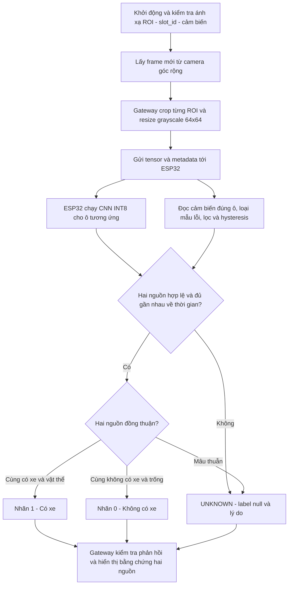

# Luồng hoạt động kết hợp khoảng cách và CNN

Sơ đồ mô tả **thiết kế đích**. Code hiện có chỉ thực hiện nhánh CNN; driver khoảng cách và fusion chưa được triển khai.

Mỗi ô có một cảm biến riêng. Mất echo, lỗi mạng, sai hash/ID hoặc dữ liệu quá hạn phải báo lỗi/UNKNOWN, không suy ra ô trống. Nếu chưa xác nhận trạng thái cảm biến lúc khởi động thì cũng là UNKNOWN. Chỉ giữ trạng thái trong vùng hysteresis khi dữ liệu cảm biến còn hợp lệ.

Ngưỡng khoảng cách hiệu chỉnh theo cách lắp; ngưỡng CNN chọn bằng validation. Khoảng cách có thể kích hoạt lượt kiểm tra mới khi có thay đổi, nhưng cần kiểm tra định kỳ cả hai nguồn để phát hiện lỗi. Chưa có worker camera tự động hoặc cơ chế đánh thức ESP32 trong code hiện tại.

Upload ảnh lưu từ trước là nhánh kiểm tra CNN độc lập, không ghép với khoảng cách hiện tại. Chi tiết quy tắc, đồng bộ và các ca kiểm thử: [sensor_fusion.md](sensor_fusion.md). SSD nằm trong [README](../README.md) và [file Mermaid](diagrams/system_sequence.mmd).
