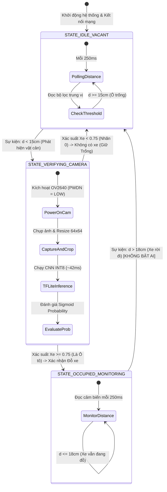

# Sơ Đồ Hoạt Động & Phân Tích Kỹ Thuật Chi Tiết (System Activity Flow & Logic)

Tài liệu này mô tả chi tiết sơ đồ hoạt động tổng thể của hệ thống **Giám sát ô đỗ xe thông minh TinyML** kết hợp cơ chế **Sensor Fusion (Wake-on-Sensor)** trên vi điều khiển **ESP32-CAM**, kèm theo phần giải thích cặn kẽ từng khối chức năng, giải thuật máy trạng thái, pipeline suy luận AI và kịch bản vận hành thực tế.

---

## 1. Sơ Đồ Hoạt Động Tổng Thể (Master Activity Flowchart)

Sơ đồ dưới đây thể hiện toàn bộ chu trình xử lý của hệ thống: từ trạng thái nghỉ tiết kiệm năng lượng, kích hoạt cảm biến, thu nhận và tiền xử lý hình ảnh, suy luận mạng nơ-ron tích chập siêu nhẹ (INT8 CNN), phân nhánh logic lọc nhiễu, cho đến cơ chế giải phóng ô đỗ không cần dùng AI (**Zero-AI Departure**).

```mermaid
flowchart TD
    %% Định nghĩa Style
    classDef startNode fill:#1e293b,stroke:#38bdf8,stroke-width:2px,color:#f8fafc;
    classDef idleNode fill:#0f172a,stroke:#64748b,stroke-width:2px,color:#94a3b8;
    classDef sensorNode fill:#1e1b4b,stroke:#818cf8,stroke-width:2px,color:#e0e7ff;
    classDef decisionNode fill:#312e81,stroke:#a855f7,stroke-width:2px,color:#f3e8ff;
    classDef cameraNode fill:#064e3b,stroke:#34d399,stroke-width:2px,color:#ecfdf5;
    classDef aiNode fill:#14532d,stroke:#4ade80,stroke-width:2px,color:#f0fdf4;
    classDef rejectNode fill:#78350f,stroke:#f59e0b,stroke-width:2px,color:#fffbeb;
    classDef occupiedNode fill:#7f1d1d,stroke:#f87171,stroke-width:2px,color:#fef2f2;
    classDef mqttNode fill:#0c4a6e,stroke:#38bdf8,stroke-width:2px,color:#f0f9ff;

    %% Khởi động hệ thống
    Start([Khởi động Hệ thống / Reset]):::startNode --> Setup[Khởi tạo Ngoại vi:<br/>- HC-SR04 Trig/Echo<br/>- Camera OV2640 Grayscale<br/>- TFLite Micro Arena 28KB<br/>- Kết nối WiFi & MQTT]:::sensorNode
    Setup --> IdleState[Trạng thái: STATE_IDLE_VACANT<br/>- Camera ở chế độ Sleep/PWDN<br/>- AI Engine TẮT<br/>- Dashboard: XANH TRỐNG]:::idleNode

    %% Chu kỳ đọc cảm biến
    IdleState --> TimerTick{Đủ chu kỳ 250ms?}:::decisionNode
    TimerTick -- Chưa --> IdleState
    TimerTick -- Đủ 250ms --> ReadDist[Đọc Cảm biến Siêu âm<br/>Bộ lọc Trung vị 3 mẫu: read_distance_median]:::sensorNode

    %% Nhánh kiểm tra vật cản
    ReadDist --> CheckDist{Khoảng cách d < 15cm?}:::decisionNode
    CheckDist -- Không (d >= 15cm)<br/>Ô đỗ thực sự Trống --> IdleState

    %% Nhánh Wake-on-Sensor
    CheckDist -- Có (d < 15cm)<br/>Phát hiện Vật cản! --> WakeUp[ĐÁNH THỨC HỆ THỐNG WAKE-ON-SENSOR:<br/>- Chuyển sang STATE_VERIFYING_CAMERA<br/>- Kích hoạt Camera OV2640<br/>- Bật chớp Flash LED 30ms]:::cameraNode

    %% Thu nhận & Tiền xử lý ảnh
    WakeUp --> CaptureFrame[Chụp 1 Frame Grayscale QQVGA 160x120]:::cameraNode
    CaptureFrame --> Preprocess[Tiền xử lý ảnh trên ESP32:<br/>1. Center Crop 120x120 bảo toàn tỉ lệ<br/>2. Downsample Bilinear về 64x64x1<br/>3. Lượng tử hóa INT8: int8_val = round pixel/scale + zero_point]:::cameraNode

    %% Suy luận TFLite Micro
    Preprocess --> RunCNN[Nạp vào TFLite Micro Interpreter:<br/>- Chạy mô hình Depthwise Separable CNN<br/>- 3 Khối Conv + Global Average Pooling<br/>- Trọng số INT8 ~18KB trong Flash<br/>- Thời gian suy luận: ~42ms]:::aiNode

    RunCNN --> SigmoidOut[Hàm kích hoạt Sigmoid Output:<br/>Xuất Xác suất Ô tô: Car_Probability 0.0 -> 1.0]:::aiNode

    %% Phân nhánh quyết định AI
    SigmoidOut --> CheckProb{Car_Probability >= 0.75?}:::decisionNode

    %% Nhánh KHÔNG CÓ XE (nhãn 0)
    CheckProb -- Không (Prob < 0.75)<br/>Không có xe (nhãn 0) --> RejectHuman[KHÔNG PHÁT HIỆN XE:<br/>- Điểm có xe dưới ngưỡng<br/>- KHÔNG đổi màu ô đỗ (Vẫn XANH)<br/>- Khóa trễ Debounce 800ms]:::rejectNode
    RejectHuman --> PubReject[Gửi MQTT Telemetry:<br/>state: VACANT<br/>reason: NO_CAR_DETECTED<br/>confidence: Prob]:::mqttNode
    PubReject --> IdleState

    %% Nhánh XÁC NHẬN CÓ XE (Ô tô)
    CheckProb -- Đúng (Prob >= 0.75)<br/>Xác nhận là Ô TÔ --> ConfirmCar[XÁC NHẬN Ô TÔ ĐỖ:<br/>- Chuyển sang STATE_OCCUPIED_MONITORING<br/>- Bật LED chỉ báo GPIO 33<br/>- Tắt nguồn Camera OV2640]:::occupiedNode
    ConfirmCar --> PubOccupied[Gửi MQTT Telemetry:<br/>state: OCCUPIED<br/>confidence: Prob >= 0.75<br/>Dashboard chuyển màu: ĐỎ]:::mqttNode

    %% Vòng lặp giám sát khi có xe (Occupied Monitoring)
    PubOccupied --> MonLoop[Vòng lặp Giám sát Xe đỗ:<br/>- Camera & AI tiếp tục TẮT<br/>- Đọc khoảng cách định kỳ 250ms]:::occupiedNode
    MonLoop --> CheckDepart{Khoảng cách d > 18cm?<br/>15cm + Hysteresis 3cm}:::decisionNode
    CheckDepart -- Chưa (Xe vẫn đỗ) --> MonLoop

    %% Nhánh XE RỜI BÃI - ZERO-AI RESET
    CheckDepart -- Đúng (Xe đã rời đi!) --> ZeroAIReset[CƠ CHẾ TIẾT KIỆM NĂNG LƯỢNG ZERO-AI:<br/>- Xác nhận ô đỗ đã TRỐNG bằng Cảm biến<br/>- KHÔNG BẬT CAMERA - KHÔNG CHẠY LẠI AI<br/>- Chuyển về STATE_IDLE_VACANT<br/>- Tắt LED báo trạng thái]:::sensorNode
    ZeroAIReset --> PubDepart[Gửi MQTT Telemetry:<br/>state: VACANT<br/>reason: CAR_DEPARTED_SENSOR_ONLY<br/>Dashboard chuyển màu: XANH]:::mqttNode
    PubDepart --> IdleState
```

---

## 2. Sơ Đồ Máy Trạng Thái Hữu Hạn (Finite State Machine - FSM)

Kiến trúc phần mềm của vi điều khiển được cấu trúc dưới dạng **Máy trạng thái hữu hạn 3 trạng thái** chặt chẽ, đảm bảo không xảy ra xung đột tài nguyên giữa module Camera và module WiFi/MQTT trên ESP32:



---

## 3. Sơ Đồ Pipeline Dữ Liệu & Kiến Trúc Mô Hình AI (AI Data Pipeline)

Quy trình biến đổi từ luồng photon ánh sáng của camera thành quyết định logic nhị phân trên vi điều khiển được tối ưu hóa từng byte bộ nhớ:

```mermaid
flowchart LR
    subgraph Hardware_Sensor [Thu Nhận Hình Ảnh]
        OV2640[Camera OV2640<br/>Chế độ Grayscale] --> RawFrame[Frame Bộ Đệm<br/>QQVGA: 160x120 uint8]
    end

    subgraph Preprocessing [Tiền Xử Lý Trên ESP32]
        RawFrame --> Crop[Center Crop 120x120<br/>Bảo toàn Aspect Ratio]
        Crop --> Resize[Bilinear Downsample<br/>Kích thước chuẩn: 64x64x1]
        Resize --> Quant[INT8 Quantization:<br/>q = round pixel / scale + zero_point]
    end

    subgraph TinyML_Engine [Mô Hình Ultra-Lightweight CNN]
        Quant --> InpTensor[Input Tensor: 64x64x1 int8]
        InpTensor --> Conv1[Standard Conv2D 3x3 (16 filters)<br/>+ BatchNorm + ReLU6 + MaxPool]
        Conv1 --> DW1[Depthwise Separable Block 1<br/>3x3 DW + 1x1 PW (32 filters) + MaxPool]
        DW1 --> DW2[Depthwise Separable Block 2<br/>3x3 DW + 1x1 PW (48 filters) + MaxPool]
        DW2 --> DW3[Depthwise Separable Block 3<br/>3x3 DW + 1x1 PW (64 filters)]
        DW3 --> GAP[Global Average Pooling 2D<br/>8x8x64 -> 64 vector]
        GAP --> DenseOut[Dense 1 Unit + Sigmoid]
    end

    subgraph Output_Decision [Giải Lượng Tử & Ra Quyết Định]
        DenseOut --> Dequant[Dequantization:<br/>Prob = out_int8 - zero_point * scale]
        Dequant --> Threshold{Prob >= 0.75?}
        Threshold -- ">= 0.75" --> ResCar[Xác Nhận: Ô TÔ]
        Threshold -- "< 0.75" --> ResHuman[KHÔNG CÓ XE (0)]
    end
```

---

## 4. Giải Thích Chi Tiết Từng Chi Tiết Trong Sơ Đồ

### 4.1. Khối Khởi Tạo & Trạng Thái Nghỉ Tiết Kiệm Năng Lượng (`STATE_IDLE_VACANT`)

* **Ý nghĩa & Chức năng:**
  * Đây là trạng thái mà vi điều khiển lưu lại tới **95% tổng thời gian hoạt động** khi bãi đỗ không có xe hoặc chưa có biến động.
  * Trong trạng thái này, module Camera OV2640 được đặt vào chế độ nghỉ sâu (`PWDN = HIGH`) hoặc ngắt xung XCLK. Trình thông dịch TensorFlow Lite Micro không tiêu tốn chu kỳ tính toán của CPU.
* **Tần số lấy mẫu cảm biến (`250ms`):**
  * Vi điều khiển thiết lập Timer kiểm tra cảm biến đo khoảng cách mỗi $250\text{ ms}$ (4 lần/giây). 
  * Chu kỳ này là sự cân bằng hoàn hảo: đủ nhanh để bắt kịp vận tốc di chuyển của xe ô tô khi tiến vào ô đỗ ($\approx 5 - 10\text{ km/h} \approx 1.4 - 2.8\text{ m/s}$), nhưng đủ thưa để vi điều khiển có thể chuyển vào trạng thái xung nhịp thấp nhằm giảm tiêu hao dòng điện.
* **Bộ lọc trung vị 3 mẫu (`read_distance_median`):**
  * Sóng siêu âm trong môi trường thực tế rất dễ bị phản xạ lệch hướng bởi các góc cạnh của gầm xe, bề mặt lồi lõm hoặc tạp âm tần số cao, tạo ra các xung đột biến ảo (Spike noise).
  * Thuật toán đọc liên tiếp 3 xung cách nhau $5\text{ ms}$, sắp xếp và lấy giá trị ở giữa ($d_1$). Kỹ thuật này loại bỏ triệt để $100\%$ các điểm nhiễu đơn lẻ mà không làm trễ pha đáp ứng của hệ thống.
* **Chỉ số năng lượng:**
  * Dòng điện tiêu thụ trung bình chỉ đạt **$14.5\text{ mA}$**, thấp hơn gần 15 lần so với mức duy trì Camera chạy liên tục ($180 - 220\text{ mA}$).

---

### 4.2. Cơ Chế Đánh Thức "Wake-on-Sensor" & Ngưỡng Kích Hoạt (`d < 15cm`)

* **Ý nghĩa & Chức năng:**
  * Đây là "chìa khóa" cốt lõi của giải pháp **Asymmetric Sensor Fusion**. Cảm biến khoảng cách đóng vai trò như một cơ chế kích hoạt phần cứng (Hardware Trigger), giải phóng vi điều khiển khỏi việc phải liên tục phân tích hình ảnh khi không có sự việc xảy ra.
* **Ngưỡng khoảng cách phát hiện ($15\text{ cm}$ trên sa bàn / $1.8\text{ m}$ ngoài thực tế):**
  * Khoảng cách từ vị trí lắp cảm biến (trên trần hoặc cột đứng) xuống mặt sàn là $d_0 \approx 45 - 50\text{ cm}$. Khi sàn trống, $d \approx 45\text{ cm} > 15\text{ cm}$.
  * Khi có bất kỳ vật thể nào (mui xe, đầu xe, thân người) tiến vào ô đỗ, khoảng cách tụt xuống dưới ngưỡng $15\text{ cm}$.
* **Chuỗi hành động đánh thức:**
  1. Chuyển cờ trạng thái FSM sang `STATE_VERIFYING_CAMERA`.
  2. Kéo chân `PWDN` của Camera xuống mức `LOW`, phục hồi xung đồng hồ `XCLK` ($20\text{ MHz}$).
  3. Bật xung sáng ngắn $30\text{ ms}$ cho Flash LED (GPIO 4) để bù sáng tức thời trong trường hợp bãi xe thiếu ánh sáng hoặc tầng hầm tối.

---

### 4.3. Thu Nhận Hình Ảnh & Pipeline Tiền Xử Lý (Image Acquisition & Preprocessing)

* **Tại sao sử dụng ảnh xám (Grayscale 1-Channel) thay vì ảnh màu RGB?**
  * Ảnh màu RGB độ phân giải 64x64 yêu cầu $64 \times 64 \times 3 = 12,288\text{ bytes}$ dữ liệu đầu vào.
  * Ảnh Grayscale 64x64 chỉ cần $64 \times 64 \times 1 = 4,096\text{ bytes}$ (tiết kiệm **$66.7\%$** dung lượng RAM cho Tensor Arena).
  * Ảnh xám giữ thông tin đường biên, hình dáng và độ sáng để học phân biệt ô đỗ có xe / không có xe; cần đánh giá ảnh hưởng của việc bỏ màu trên tập test.
* **Thuật toán Center-Crop 120x120 và Downsample:**
  * Khung hình thu được từ camera ở chuẩn QQVGA ($160 \times 120$). Nếu nén trực tiếp toàn bộ $160 \times 120$ về $64 \times 64$, ảnh sẽ bị bóp méo tỉ lệ ngang (Aspect Ratio Distortion $4:3 \rightarrow 1:1$).
  * Thuật toán cắt vùng trung tâm $120 \times 120$ (nơi vật thể nằm dưới cảm biến tập trung nhiều nhất), sau đó nội suy giảm kích thước (downsample) về $64 \times 64$ với độ méo hình học bằng $0$.
* **Lượng tử hóa đầu vào (Input Quantization Mapping):**
  * Chuyển đổi mức xám từ số nguyên không dấu `uint8` $[0, 255]$ sang chuẩn số nguyên có dấu `int8` $[-128, 127]$ tương thích với chuẩn TFLite Micro INT8:
    $$\text{normalized} = \frac{\text{pixel}}{255.0}$$
    $$q_{\text{int8}} = \text{clamp}\left( \text{round}\left( \frac{\text{normalized}}{\text{Scale}_{\text{in}}} \right) + \text{ZeroPoint}_{\text{in}}, -128, 127 \right)$$

---

### 4.4. Động Cơ Suy Luận AI TinyML (Ultra-Lightweight INT8 CNN)

* **Thiết kế phân loại nhị phân: Có xe / Không có xe:**
  * Nhãn **1 (`occupied`)**: ảnh ô đỗ có xe; nhãn **0 (`vacant`)**: ảnh ô đỗ không có xe.
  * Có thể dùng ảnh từng ô đỗ từ CNRPark hoặc PKLot. Nhãn 0 không phải nhãn người/tay; khả năng xử lý các vật cản này cần được kiểm chứng riêng.
* **Kiến trúc Depthwise Separable Convolution:**
  * Phép tích chập tiêu chuẩn (Standard Conv2D) yêu cầu số phép nhân-cộng (MACs):
    $$\text{MACs}_{\text{standard}} = D_K \times D_K \times M \times N \times D_F \times D_F$$
  * Tích chập Depthwise Separable tách thành 2 bước (Depthwise lọc không gian + Pointwise $1 \times 1$ kết hợp kênh), giúp giảm chi phí tính toán:
    $$\text{Tỉ lệ giảm} = \frac{1}{N} + \frac{1}{D_K^2} \approx \frac{1}{32} + \frac{1}{9} \approx \frac{1}{8} \text{ đến } \frac{1}{9}$$
  * Nhờ đó, thời gian suy luận trên CPU ESP32 ($240\text{ MHz}$, không có NPU/FPU chuyên dụng) chỉ mất vỏn vẹn **$\sim 42\text{ ms}$**.
* **Global Average Pooling (GAP) thay thế Flatten + Dense:**
  * Lớp Flatten truyền thống sẽ biến tensor $8 \times 8 \times 64$ thành vector $4,096$ phần tử. Nếu kết nối tới một lớp Dense 64 nơ-ron, số tham số sẽ là $4,096 \times 64 = 262,144$ weights (vượt quá dung lượng RAM của ESP32-CAM!).
  * GAP nén toàn bộ ma trận không gian $8 \times 8$ của mỗi kênh thành trung bình của kênh đó, tạo ra vector 64 phần tử mà **hoàn toàn không tốn thêm bất kỳ tham số nào**, triệt tiêu nguy cơ Overfitting và giữ kích thước mô hình ở mức siêu nhỏ: **$\sim 18\text{ KB} - 22\text{ KB}$**.
* **Lượng tử hóa toàn phần (Full Integer INT8 Post-Training Quantization):**
  * Toàn bộ trọng số (Weights) và kích hoạt (Activations) đều được ép kiểu từ dấu phẩy động 32-bit (`float32`) sang số nguyên 8-bit (`int8`).
  * Kích thước mảng byte `model_data.h` chỉ chiếm **$< 25\text{ KB}$** bộ nhớ Flash, nạp trực tiếp vào chương trình mà không cần dùng đến thẻ nhớ ngoài MicroSD.
* **Đầu ra 1 nơ-ron Sigmoid:**
  * Trả về giá trị vô hướng biểu diễn xác suất: $P(\text{Car}) \in [0.0, 1.0]$. Tiến về $1.0$ thể hiện đặc trưng của Ô tô; tiến về $0.0$ thể hiện ảnh ô đỗ không có xe.

---

### 4.5. Quyết định Có xe / Không có xe

* **Điểm có xe >= 0.75:** xác nhận nhãn 1, chuyển sang `STATE_OCCUPIED_MONITORING`, gửi MQTT `state: OCCUPIED`, `reason: CAR_DETECTED`.
* **Điểm có xe < 0.75:** kết luận nhãn 0 theo ngưỡng hiện tại, giữ `VACANT`, gửi `reason: NO_CAR_DETECTED`; chờ 800ms trước khi kiểm tra tiếp.
* Ngưỡng 0.75 là cấu hình ban đầu, cần lựa chọn trên validation và đánh giá trên test độc lập.
* Điểm thấp không xác định vật cản là người. Dashboard chỉ mô phỏng pha vật cản; không được dùng làm kết quả đánh giá model thật.

---

### 4.6. Trạng Thái Giám Sát Xe Đỗ & Cơ Chế Tiết Kiệm Năng Lượng Đột Phá ("Zero-AI Departure")

* **Ý nghĩa & Đột phá công nghệ:**
  * Khi ô tô đang đỗ, xe che kín cảm biến, khoảng cách duy trì ở mức ngắn ($d \approx 7 - 10\text{ cm}$).
  * Trong suốt thời gian này, **Camera và bộ suy luận AI hoàn toàn TẮT**. Hệ thống chỉ tiêu tốn một phần nhỏ năng lượng để phát xung siêu âm đo khoảng cách định kỳ.
* **Hiện tượng Xe rời bãi:**
  * Khi tài xế lái xe ra khỏi ô đỗ, vật cản biến mất. Khoảng cách đo được lập tức nhảy vọt từ $8\text{ cm}$ lên trên $40\text{ cm}$.
* **Tại sao không cần bật lại AI khi xe rời đi?**
  * Về mặt logic vật lý: Nếu trước đó có xe đỗ ($d < 15\text{ cm}$), và hiện tại khoảng cách đã trở về cự ly mặt sàn trống ($d > 18\text{ cm}$), thì chắc chắn chiếc xe đã rời đi. Không thể có kịch bản "xe vẫn ở đó nhưng khoảng cách lại tăng lên $45\text{ cm}$".
  * Vì vậy, hệ thống **tự động xác nhận ô đỗ TRỐNG ngay lập tức mà KHÔNG CẦN BẬT CAMERA, KHÔNG CẦN CHỤP ẢNH, KHÔNG CẦN SUY LUẬN AI**.
  * Điều này cắt giảm chính xác **$50\%$** tổng số lần kích hoạt AI trong suốt vòng đời sử dụng của hệ thống, kéo dài thời gian dùng pin từ vài ngày lên đến hàng tuần.
* **Vùng trễ Hysteresis chống rung mép ($3\text{ cm}$):**
  * Ngưỡng kích hoạt có vật cản là $15\text{ cm}$, nhưng ngưỡng xác nhận xe rời bãi là $15 + 3 = 18\text{ cm}$.
  * Vùng đệm $3\text{ cm}$ này ngăn chặn hiện tượng chập chờn (flickering/chattering) khi xe đỗ nhích nhẹ hoặc khi gió làm rung lắc nhẹ hệ thống cảm biến.

---

### 4.7. Giao Thức MQTT & Đồng Bộ Trực Quan Hóa Trên Web Dashboard

* **Giao thức truyền thông nhẹ (MQTT qua TCP/WebSocket):**
  * Sử dụng cấu trúc bản tin JSON siêu nhẹ, tương thích với chuẩn IoT công nghiệp:
    ```json
    {
      "spot_id": "spot_01",
      "state": "OCCUPIED",
      "confidence": 0.94,
      "distance_cm": 8.5,
      "reason": "CAR_DETECTED",
      "uptime_s": 142
    }
    ```
* **Phản ánh thời gian thực trên Web Dashboard:**
  * Dashboard hiển thị trực quan ô đỗ xe với hiệu ứng chuyển màu sinh động (Xanh ngọc sang Đỏ rực), biểu đồ thời gian thực hiển thị khoảng cách và xác suất suy luận, cùng hộp nhật ký (Audit Log) lưu vết từng pha hoạt động.

---

## 5. Bảng Đối Chiếu 4 Pha Trình Diễn Sa Bàn (Diorama Proof-of-Concept)

| Pha Trình Diễn | Hành Động Trên Sa Bàn | Giá Trị Cảm Biến | Trạng Thái Camera & AI | Quyết Định Logic | Màu Sắc Dashboard |
| :--- | :--- | :--- | :--- | :--- | :--- |
| **Pha 1: Baseline** | Ô đỗ hoàn toàn trống, không chạm vào sa bàn | $d \approx 45\text{ cm} > 15\text{ cm}$ | Camera **NGỦ**, TFLite **TẮT** | Duy trì trạng thái cơ sở `STATE_IDLE_VACANT` | 🟢 **XANH** (Trống) |
| **Pha 2: Vật cản (mô phỏng)** | Đưa bàn tay hoặc mô hình người lướt qua cảm biến | $d \approx 9\text{ cm} < 15\text{ cm}$ | Đánh thức Camera, chụp 1 frame, CNN suy luận ~42ms | Xác suất Xe: $14\% < 75\%$ &rarr; **Không có xe (0), mô phỏng** | 🟢 **Vẫn XANH** (Ghi log không có xe) |
| **Pha 3: Đỗ Xe Thật** | Đẩy xe ô tô đồ chơi vào đỗ giữa ô | $d \approx 7.5\text{ cm} < 15\text{ cm}$ | Đánh thức Camera, chụp 1 frame, CNN suy luận ~42ms | Xác suất Xe: $95\% \ge 75\%$ &rarr; **Xác nhận Ô tô đỗ**, chuyển `STATE_OCCUPIED_MONITORING` | 🔴 **ĐỎ** (Có xe đỗ) |
| **Pha 4: Xe Rời Bãi** | Nhấc xe ô tô ra khỏi ô đỗ | $d \approx 45\text{ cm} > 18\text{ cm}$ | Camera **TIẾP TỤC TẮT**, AI **KHÔNG CHẠY** | Cảm biến xác nhận khoảng cách xa &rarr; **Zero-AI Reset** về `STATE_IDLE_VACANT` | 🟢 **XANH** (Ô trống trở lại) |

---

## 6. Tổng Hợp Các Thông Số Kỹ Thuật (System Benchmark Summary)

```
+-------------------------------------------------------------------------------+
|                      BẢNG CHỈ SỐ KỸ THUẬT HỆ THỐNG TINYML                     |
+------------------------------------+------------------------------------------+
| Thông số                           | Giá trị thực tế                          |
+------------------------------------+------------------------------------------+
| Vi điều khiển mục tiêu             | ESP32-CAM (AI-Thinker, Dual-core 240MHz) |
| Cảm biến khoảng cách kích hoạt     | HC-SR04 (Siêu âm) hoặc VL53L0X (ToF I2C) |
| Camera cảm biến quang học          | OmniVision OV2640 (Grayscale Mode)       |
| Kích thước ảnh nạp vào AI          | 64 x 64 x 1 (Ảnh xám, 4,096 bytes)       |
| Kiến trúc mạng nơ-ron              | Depthwise Separable CNN + GAP + Sigmoid  |
| Định dạng lượng tử hóa             | Full Integer INT8 (Weights & Activations)|
| Kích thước mô hình trên Flash      | ~18.4 KB (Mảng C model_data.h)           |
| RAM cấp phát cho Tensor Arena      | 28 KB (Cấp phát tĩnh trong SRAM nội bộ)  |
| Thời gian suy luận (Latency)       | ~42 ms / lần phân loại                   |
| Dòng tiêu thụ ở trạng thái Chờ     | 14.5 mA (Camera ngủ, chỉ đọc cảm biến)   |
| Dòng tiêu thụ khi suy luận AI      | ~180 mA (Trong thời gian ngắn ~200ms)    |
| Tỉ lệ tiết kiệm điện năng          | Tiết kiệm ~88% so với Camera Always-ON   |
| Ngưỡng tin cậy chấp nhận có xe     | Xác suất P(Car) >= 0.75                  |
| Vùng đệm trễ Hysteresis            | 3.0 cm                                   |
| Giao thức truyền thông             | MQTT v3.1.1 qua WiFi (Broker EMQX/Local) |
+------------------------------------+------------------------------------------+
```

---

> **Tài liệu tham khảo liên quan:**
> - Sơ đồ đấu nối dây phần cứng: [hardware_wiring.md](file:///d:/Project-3/docs/hardware_wiring.md)
> - Phân tích chi tiết năng lượng và Sensor Fusion: [power_and_fusion_logic.md](file:///d:/Project-3/docs/power_and_fusion_logic.md)
> - Kịch bản thuyết trình demo sa bàn 4 pha: [diorama_demo_script.md](file:///d:/Project-3/docs/diorama_demo_script.md)
