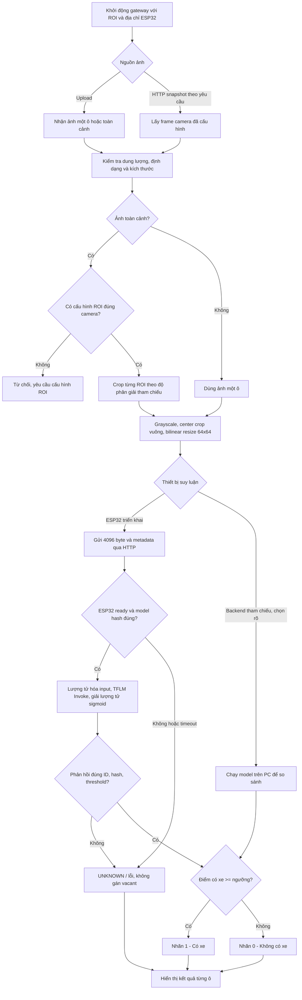

# Luồng hoạt động camera góc rộng và ESP32

Các ROI xử lý tuần tự. Nếu ESP32 lỗi ở một ROI, các ROI còn lại của frame được đánh dấu UNKNOWN thay vì tiếp tục chờ timeout lặp lại. Frame mới phải được yêu cầu lại; chưa có worker lấy video tự động hoặc cơ sở dữ liệu lịch sử.

Trạng thái trống/có xe đều được quyết định từ model cho mỗi lượt xử lý. Không còn nhánh xe rời đi chỉ dùng cảm biến hoặc cơ chế Wake-on-Sensor.

SSD có trong [README](../README.md) và [file Mermaid](diagrams/system_sequence.mmd). Kiến trúc, giao thức và giới hạn triển khai ở [system_architecture.md](system_architecture.md).
