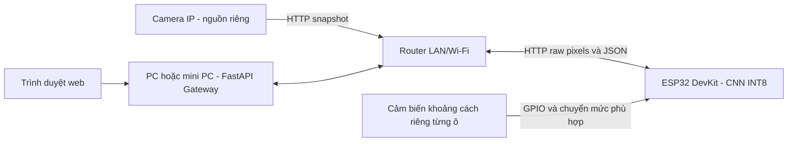

# Kết nối camera góc rộng, cảm biến khoảng cách, gateway và ESP32

Thiết kế đích bổ sung cảm biến theo từng ô; firmware hiện mới có HTTP/CNN, chưa đọc cảm biến hay fusion. Phần đấu nối dưới đây cần hoàn thiện theo đúng module và board thực tế trước khi nạp driver.

## Phần cứng

- Camera IP góc rộng cố định, hoặc camera cung cấp ảnh để upload thủ công.
- PC/mini PC chạy FastAPI gateway, có kết nối đến camera và ESP32.
- ESP32 DevKit/ESP32-WROOM thông thường, không yêu cầu module camera.
- Một module đo khoảng cách cho mỗi ô cần giám sát, ví dụ HC-SR04 cho sa bàn; linh kiện chuyển mức phù hợp với tín hiệu module.
- Nguồn phù hợp cho từng thiết bị; gateway và ESP32 cùng mạng LAN/Wi-Fi.

Camera IP không nối vào chân GPIO của ESP32. Trong thiết kế đích, cảm biến khoảng cách nối GPIO ESP32; ảnh vẫn đi qua mạng từ gateway. Driver cảm biến và fusion chưa có trong firmware hiện tại. Kết nối USB ESP32 với máy tính dùng để nạp firmware và đọc Serial Monitor 115200 baud.

## Cảm biến khoảng cách theo từng ô

| Tín hiệu | Kết nối dự kiến |
|---|---|
| Nguồn cảm biến | Theo điện áp yêu cầu của đúng phiên bản module |
| GND | Chung mass với ESP32 |
| Trigger nếu dùng module kiểu HC-SR04 | GPIO output khả dụng của board |
| Echo nếu dùng module kiểu HC-SR04 | GPIO input qua mạch chuyển mức/chia áp nếu tín hiệu cao hơn mức GPIO cho phép |

Không nối trực tiếp tín hiệu Echo 5 V vào GPIO ESP32. Kiểm tra datasheet đúng module và board để chọn nguồn, chuyển mức và GPIO; chưa chốt pinout hoặc giá trị điện trở trong bản thiết kế này. Tránh chân dùng cho flash/boot hoặc ngoại vi đang hoạt động. Dùng cảm biến loại khác thì giao tiếp và driver phải thay tương ứng.

Lập bảng `slot_id → ROI → sensor_id → GPIO` theo phần cứng thực tế. Một cảm biến không đại diện cho nhiều ô độc lập. Nếu nhiều cảm biến siêu âm, đo tuần tự và bố trí chu kỳ để giảm nhiễu chéo. Hiệu chỉnh khoảng cách khi trống/có xe cho từng ô; không dùng nguyên ngưỡng mẫu cho mọi vị trí lắp.

Trước khi nối với CNN, kiểm tra riêng số đo, timeout và ánh xạ từng ô trên Serial Monitor. Sau đó kiểm thử đồng thuận/mâu thuẫn theo [sensor_fusion.md](sensor_fusion.md). Chưa xác nhận compile/đấu nối/chạy fusion trên board thật.

## Nạp firmware CNN hiện có

1. Cài board package ESP32 cho Arduino IDE và thư viện TensorFlow Lite Micro tương thích API trong sketch.
2. Mở `firmware_esp32/esp32_parking_inference/esp32_parking_inference.ino` và chọn đúng board/COM của ESP32 DevKit đang dùng.
3. Sửa Wi-Fi trong `esp32_config.h`; xuất `model_data.h` từ model INT8 đã kiểm tra.
4. Nạp firmware, xem Serial Monitor để kiểm tra model, arena, heap và IP.
5. Gọi `http://<ip>/health`: chỉ dùng suy luận khi `ready: true` và hash model khớp file gateway.
6. Khởi động gateway với `--esp32-url http://<ip>`.

Board DevKit thường có auto boot/reset khi nạp; cách vào boot phụ thuộc board cụ thể, không áp dụng sơ đồ GPIO0 của module camera cũ.

## Bộ nhớ và kiểm thử

ESP32 có 520 KB SRAM tổng nhưng không phải toàn bộ dành cho tensor arena; Wi-Fi, HTTP, stack và runtime đều cần bộ nhớ. [Datasheet Espressif](https://documentation.espressif.com/esp32_datasheet_en.html)

Arena trong mã nguồn khởi đầu 160 KiB, chưa được xác nhận bằng board thật. Khi không đủ RAM hoặc `AllocateTensors()` lỗi, firmware trả 503 thay vì tạo nhãn 0. Đo heap sau khi Wi-Fi kết nối và chạy lặp nhiều ROI trước khi kết luận hệ thống ổn định.

Môi trường project hiện chưa có toolchain Arduino để xác nhận compile/flash. API TFLite Micro thay đổi theo thư viện; chọn bản tương thích constructor và resolver trong sketch. Giao thức được mô tả ở [system_architecture.md](system_architecture.md).

Sketch cần Arduino-ESP32 WebServer có `HTTPRaw`/`raw()` callback. Dữ liệu pixel có thể chứa byte 0 nên không đọc qua `arg("plain")`, vốn có thể xử lý như chuỗi kết thúc bằng NUL. Firmware dùng buffer raw cố định 4096 byte và kiểm tra đã nhận đủ payload.
