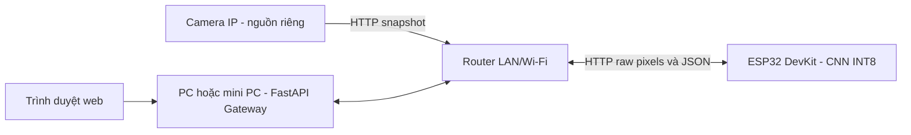

# Kết nối camera góc rộng, gateway và ESP32

## Phần cứng

- Camera IP góc rộng cố định, hoặc camera cung cấp ảnh để upload thủ công.
- PC/mini PC chạy FastAPI gateway, có kết nối đến camera và ESP32.
- ESP32 DevKit/ESP32-WROOM thông thường, không yêu cầu module camera.
- Nguồn phù hợp cho từng thiết bị; gateway và ESP32 cùng mạng LAN/Wi-Fi.

Camera IP không nối vào chân GPIO của ESP32. Firmware hiện không dùng HC-SR04, flash camera, thẻ SD hoặc UART để truyền ảnh. Kết nối USB ESP32 với máy tính dùng để nạp firmware và đọc Serial Monitor 115200 baud.

## Nạp firmware

1. Cài board package ESP32 cho Arduino IDE và thư viện TensorFlow Lite Micro tương thích API trong sketch.
2. Mở `firmware_esp32/esp32_parking_inference/esp32_parking_inference.ino` và chọn đúng board/COM của ESP32 DevKit đang dùng.
3. Sửa Wi-Fi trong `esp32_config.h`; xuất `model_data.h` từ model INT8 đã kiểm tra.
4. Nạp firmware, xem Serial Monitor để kiểm tra model, arena, heap và IP.
5. Gọi `http://<ip>/health`: chỉ dùng suy luận khi `ready: true` và hash model khớp file gateway.
6. Khởi động gateway với `--esp32-url http://<ip>`.

Board DevKit thường có auto boot/reset khi nạp; cách vào boot phụ thuộc board cụ thể, không áp dụng sơ đồ GPIO0 của module camera cũ.

## Bộ nhớ và kiểm thử

ESP32 có 520 KB SRAM tổng nhưng không phải toàn bộ dành cho tensor arena; Wi-Fi, HTTP, stack và runtime đều cần bộ nhớ. [Datasheet Espressif](https://documentation.espressif.com/esp32_datasheet_en.html)

Arena trong mã nguồn khởi đầu 160 KiB, chưa được xác nhận bằng board thật. Khi không đủ RAM hoặc `AllocateTensors()` lỗi, firmware trả 503 thay vì tạo nhãn 0. Đo heap sau khi Wi-Fi kết nối và chạy lặp nhiều ROI trước khi kết luận hệ thống ổn định.

Môi trường project hiện chưa có toolchain Arduino để xác nhận compile/flash. API TFLite Micro thay đổi theo thư viện; chọn bản tương thích constructor và resolver trong sketch. Giao thức được mô tả ở [system_architecture.md](system_architecture.md).

Sketch cần Arduino-ESP32 WebServer có `HTTPRaw`/`raw()` callback. Dữ liệu pixel có thể chứa byte 0 nên không đọc qua `arg("plain")`, vốn có thể xử lý như chuỗi kết thúc bằng NUL. Firmware dùng buffer raw cố định 4096 byte và kiểm tra đã nhận đủ payload.
